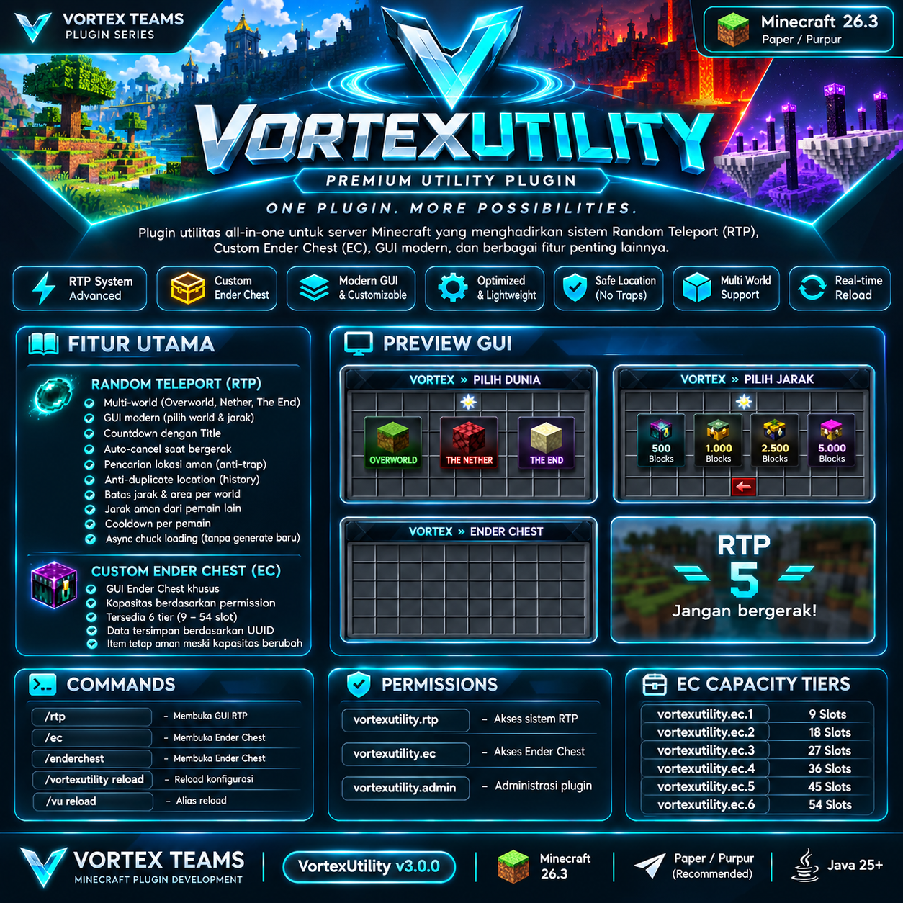

⚡ VORTEX UTILITY

ADVANCED MINECRAFT UTILITY SYSTEM

ONE PLUGIN. MORE POSSIBILITIES.

"Platform" (https://img.shields.io/badge/Platform-Paper%20%7C%20Purpur-00D9FF?style=for-the-badge)

"Java" (https://img.shields.io/badge/Java-25-orange?style=for-the-badge&logo=openjdk)

"Minecraft" (https://img.shields.io/badge/Minecraft-26.3-55CC55?style=for-the-badge&logo=minecraft)

"Developer" (https://img.shields.io/badge/Developer-Vortex%20Teams-8B5CF6?style=for-the-badge)

  

Developed with ❤️ by VORTEX TEAMS

Building Better Minecraft Experiences.

---

🌌 ABOUT THE PROJECT

VortexUtility is a modern Minecraft utility plugin developed by Vortex Teams.

Designed to combine essential server utilities into one powerful, customizable, and performance-focused system.

Featuring an advanced Random Teleport system and a permission-based Custom Ender Chest, VortexUtility provides useful tools for modern Minecraft servers.

«Your Server. Your System. Your Experience.»

---

⚡ CORE FEATURES

🌍 ADVANCED RANDOM TELEPORT

Explore your Minecraft world with an advanced Random Teleport system.

FEATURES

- Multi-world support.
- Overworld, Nether & The End.
- Interactive RTP GUI.
- Customizable teleport distance.
- Title-based teleport countdown.
- Anti-movement cancellation.
- Safe location detection.
- RTP location history.
- Avoids recently used locations.
- Custom coordinate boundaries per world.
- Minimum distance from other players.
- Individual player cooldown.
- Asynchronous chunk loading.
- No forced generation of new chunks.

📦 CUSTOM ENDER CHEST

A flexible storage system with permission-based capacity.

FEATURES

- Dedicated Custom Ender Chest GUI.
- Six configurable storage tiers.
- Storage capacity up to 54 slots.
- UUID-based player data storage.
- Persistent item storage.
- Permission-based capacity upgrades.
- Preserves stored items when capacity changes.

⚙️ CONFIGURATION SYSTEM

Take control of your server utilities with flexible configuration options.

AVAILABLE SETTINGS

- Separate configuration files.
- Custom messages and notifications.
- Configurable RTP worlds and boundaries.
- Adjustable teleport cooldown.
- Customizable countdown duration.
- Configurable search attempt limits.
- Concurrent RTP search limits.
- RTP history settings.
- GUI appearance settings.
- Configuration reload without server restart.

---

🖥️ GUI SHOWCASE

WORLD SELECTION

Choose your destination through an interactive inventory interface.

- Overworld
- The Nether
- The End

DISTANCE SELECTION

Select your preferred teleport distance.

- 500 Blocks
- 1,000 Blocks
- 2,500 Blocks
- 5,000 Blocks

Available distances depend on the selected world's configuration.

RTP COUNTDOWN

Stay still while the teleport countdown is running.

Moving during the countdown cancels the teleportation.

CUSTOM ENDER CHEST

A dedicated storage interface with permission-based inventory capacity.

---

⌨️ COMMANDS

PLAYER COMMANDS

Command| Description
"/rtp"| Open Random Teleport GUI
"/ec"| Open Custom Ender Chest
"/enderchest"| Open Custom Ender Chest

ADMIN COMMANDS

Command| Description
"/vortexutility reload"| Reload plugin configuration
"/vu reload"| Reload configuration alias

---

🔐 PERMISSIONS

GENERAL PERMISSIONS

Permission| Description
"vortexutility.rtp"| Access Random Teleport
"vortexutility.ec"| Access Custom Ender Chest
"vortexutility.admin"| Plugin administration

ENDER CHEST CAPACITY

Permission| Storage Capacity
"vortexutility.ec.1"| 9 Slots
"vortexutility.ec.2"| 18 Slots
"vortexutility.ec.3"| 27 Slots
"vortexutility.ec.4"| 36 Slots
"vortexutility.ec.5"| 45 Slots
"vortexutility.ec.6"| 54 Slots

---

📂 CONFIGURATION

VortexUtility automatically generates its configuration files after the first server startup.

DIRECTORY STRUCTURE

plugins/
└── VortexUtility/
    │
    ├── config.yml
    ├── messages.yml
    ├── rtp.yml
    ├── ec.yml
    │
    └── data/
        └── enderchests/
            └── <UUID>.yml

CONFIGURATION FILES

File| Purpose
"config.yml"| General settings and GUI
"messages.yml"| Messages and notifications
"rtp.yml"| Random Teleport configuration
"ec.yml"| Ender Chest configuration
"data/"| Player storage data

RTP WORLD CONFIGURATION

Each world can be configured independently.

- Enable or disable RTP per world.
- Set world center coordinates.
- Define minimum and maximum X/Z boundaries.
- Configure minimum and maximum teleport distance.
- Set maximum location search attempts.
- Configure minimum distance from other players.

RTP HISTORY

Control how the RTP history system works.

- Enable or disable location history.
- Set the maximum number of saved locations.
- Configure minimum distance from previous RTP locations.
- Maintain separate history for each player and world.

PERFORMANCE SETTINGS

- Maximum concurrent RTP searches.
- Maximum location search attempts.
- Asynchronous chunk loading.
- Controlled location searching.
- No forced new chunk generation.

«IMPORTANT

Pregenerate your RTP areas using Chunky before enabling RTP.

Make sure the configured coordinate boundaries match the pregenerated area in each world.

VortexUtility does not request the generation of new chunks during RTP searches.»

---

🚀 INSTALLATION GUIDE

Follow these steps to install VortexUtility.

STEP 01 — DOWNLOAD

Download the latest "VortexUtility.jar" from the GitHub Releases section.

STEP 02 — UPLOAD

Place the JAR file inside your Minecraft server's "plugins/" directory.

STEP 03 — RESTART

Restart your Paper or Purpur server.

STEP 04 — CONFIGURE

Open the "plugins/VortexUtility/" folder and customize the configuration files.

STEP 05 — ENJOY

Start using VortexUtility with:

/rtp
/ec

---

🧩 REQUIREMENTS

Component| Version
Minecraft| 26.3
Server Software| Paper / Purpur
Java| 25
Chunky| Recommended for RTP pregeneration

---

💎 PROJECT INFORMATION

Information| Details
Project Name| VortexUtility
Developer| Vortex Teams
Category| Minecraft Utility Plugin
Main Features| Random Teleport & Custom Ender Chest
Platform| Paper / Purpur
Programming Language| Java

---

🏆 DEVELOPED BY

⚡ VORTEX TEAMS

MINECRAFT PLUGIN DEVELOPMENT

Developing modern systems, custom plugins, and powerful solutions for Minecraft servers.

INNOVATION · PERFORMANCE · QUALITY

---

VORTEX UTILITY

ONE PLUGIN. MORE POSSIBILITIES.

Developed with ❤️ by VORTEX TEAMS

Your Server. Your System. Your Experience.

